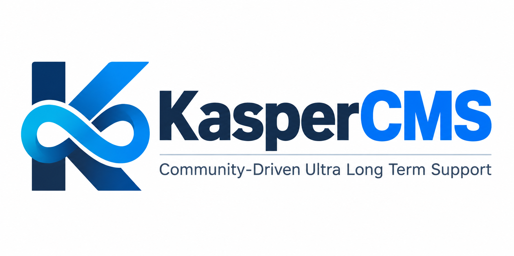

<p align="center">
  
</p>

# KasperCMS

**Independent Community Fork of TYPO3 CMS**

Community-driven Ultra Long Term Support (ULTS)

KasperCMS is an independent, open-source community fork based on TYPO3 CMS.

The project aims to provide extended maintenance (security fixes and bug
fixes) for TYPO3 versions that have reached their official end of support.

## Project Goals

- Free and open-source extended maintenance
- Community-maintained backports of security fixes and bug fixes
- Long-term support for legacy TYPO3 installations
- Minimal changes to the original TYPO3 architecture
- Transparent development and publicly available security patches
- No subscription required

KasperCMS backports fixes that are publicly available: from newer TYPO3
branches, from TYPO3 security advisories and from the upstream projects of
bundled libraries. Fixes that are not publicly available cannot be
included. What each release covers is documented in its coverage matrix
in [ULTS-PROCESS.md](ULTS-PROCESS.md).

## Current Focus

**TYPO3 CMS 12.4 LTS**

The initial goal is to maintain a community-supported branch with security
fixes and bug fixes beyond the official free support period, which ended on
2026-04-30.

Development happens on the `12.4-ults` branch.

## Roadmap

To keep the maintenance effort low, KasperCMS covers **every second TYPO3 LTS
version** (12, 14, 16, …). Support for a version starts when its free TYPO3
community support ends.

| TYPO3 LTS | Free community support until | KasperCMS ULTS |
|---|---|---|
| 11.5 | 2024-10-31 | not planned |
| **12.4** | 2026-04-30 | **active, at least until 2030-12-31** |
| 13.4 | 2027-12-31 | not planned |
| 14 LTS | 2029-06-30 | planned from 2029-07-01 |
| 16 LTS | not yet announced | planned |

Support periods are reviewed every year and extended where possible. The end
of support for a version is announced at least 12 months in advance. Support
beyond 2029 includes compatibility with new PHP versions.

Dates of the free community support are taken from
[get.typo3.org](https://get.typo3.org/).

## PHP Version

Run KasperCMS on a PHP version that still receives security updates from the
PHP project, currently **PHP 8.3, 8.4 or 8.5**. TYPO3 12.4 also runs on PHP
8.1 and 8.2, but PHP 8.1 reached its end of life on 2025-12-31 and PHP 8.2
receives security fixes only until 2026-12-31. See the
[supported PHP versions](https://www.php.net/supported-versions.php).

## Releases

| KasperCMS version | Release date | Based on | Fixes | Notes |
|---|---|---|---|---|
| **12.4.45.5** | 2026-10-12 | KasperCMS 12.4.45.4 | – (no new advisories) | KasperCMS logo and colours in the backend, see [coverage matrix](ULTS-PROCESS.md#coverage-matrix-124455) |
| 12.4.45.4 | 2026-10-12 | KasperCMS 12.4.45.3 | 28 upstream bug fixes, cache tag quoting, build tool updates | See [coverage matrix](ULTS-PROCESS.md#coverage-matrix-124454) |
| 12.4.45.3 | 2026-10-11 | KasperCMS 12.4.45.2 | Backend live search page mounts | See [coverage matrix](ULTS-PROCESS.md#coverage-matrix-124453) |
| 12.4.45.2 | 2026-10-10 | KasperCMS 12.4.45.1 | Suggest wizard table permissions, absolute path handling | See [coverage matrix](ULTS-PROCESS.md#coverage-matrix-124452) |
| 12.4.45.1 | 2026-10-10 | TYPO3 CMS 12.4.45 | 11 TYPO3 core CVEs, library updates | First KasperCMS release, see [coverage matrix](ULTS-PROCESS.md#coverage-matrix-124451) |
| 12.4.45 | 2026-04-14 | – | – | Last official community release of TYPO3 CMS 12.4 (upstream base) |

The next release in development is **12.4.45.6** (`12.4.45.6-dev`).

### Versioning

KasperCMS releases are numbered `12.4.45.N` and count up independently with
every release (`12.4.45.1`, `12.4.45.2`, …):

- `12.4.45` is the last official TYPO3 CMS release KasperCMS 12.4 is based
  on.
- Version numbers of official TYPO3 releases are never reused, so a
  KasperCMS installation can always be told apart from an official one.
- Composer treats four-part versions as stable and orders them directly
  after `12.4.45`. Extension constraints like `^12.4` are satisfied.

`12.4.45` follows TYPO3's MAJOR.MINOR.PATCH scheme. The fourth part `N` is
the KasperCMS revision below PATCH: like a patch release, a revision only
contains security fixes and bug fixes, never new features or breaking
changes. Four-part numbers are not Semantic Versioning, so tools that expect
exactly three parts may fail to parse them (see
[Known Limitations](#known-limitations)).

Alternative schemes were rejected: a suffix like `12.4.45-ults.4` is not a
valid Composer version, and a number like `12.4.1004` would look like an
official release and make advisory scanners treat KasperCMS as newer than
every official fix, also for fixes that are not backported yet.

## Installation with Composer

Composer 2.9 and newer refuse to install package versions that are affected
by known security advisories (`policy.advisories.block`, enabled by default).
Advisory databases compare version numbers only: `12.4.45.N` falls into the
ranges of all TYPO3 advisories fixed after 12.4.45, also when KasperCMS
contains the fix. Composer then stops with "these were not loaded, because
they are affected by security advisories".

Allow the KasperCMS packages in the root `composer.json` of your project.
Composer 2.10 does not support wildcards or version constraints for this
setting, so every `typo3/cms-*` package has to be listed, including those
that are only required by extensions:

<details>
<summary>Policy configuration for all TYPO3 12.4 packages</summary>

```json
{
    "config": {
        "policy": {
            "advisories": {
                "ignore": {
                    "typo3/cms-adminpanel": {"reason": "KasperCMS", "on-audit": false},
                    "typo3/cms-backend": {"reason": "KasperCMS", "on-audit": false},
                    "typo3/cms-belog": {"reason": "KasperCMS", "on-audit": false},
                    "typo3/cms-beuser": {"reason": "KasperCMS", "on-audit": false},
                    "typo3/cms-core": {"reason": "KasperCMS", "on-audit": false},
                    "typo3/cms-dashboard": {"reason": "KasperCMS", "on-audit": false},
                    "typo3/cms-extbase": {"reason": "KasperCMS", "on-audit": false},
                    "typo3/cms-extensionmanager": {"reason": "KasperCMS", "on-audit": false},
                    "typo3/cms-felogin": {"reason": "KasperCMS", "on-audit": false},
                    "typo3/cms-filelist": {"reason": "KasperCMS", "on-audit": false},
                    "typo3/cms-filemetadata": {"reason": "KasperCMS", "on-audit": false},
                    "typo3/cms-fluid": {"reason": "KasperCMS", "on-audit": false},
                    "typo3/cms-fluid-styled-content": {"reason": "KasperCMS", "on-audit": false},
                    "typo3/cms-form": {"reason": "KasperCMS", "on-audit": false},
                    "typo3/cms-frontend": {"reason": "KasperCMS", "on-audit": false},
                    "typo3/cms-impexp": {"reason": "KasperCMS", "on-audit": false},
                    "typo3/cms-indexed-search": {"reason": "KasperCMS", "on-audit": false},
                    "typo3/cms-info": {"reason": "KasperCMS", "on-audit": false},
                    "typo3/cms-install": {"reason": "KasperCMS", "on-audit": false},
                    "typo3/cms-linkvalidator": {"reason": "KasperCMS", "on-audit": false},
                    "typo3/cms-lowlevel": {"reason": "KasperCMS", "on-audit": false},
                    "typo3/cms-opendocs": {"reason": "KasperCMS", "on-audit": false},
                    "typo3/cms-reactions": {"reason": "KasperCMS", "on-audit": false},
                    "typo3/cms-recycler": {"reason": "KasperCMS", "on-audit": false},
                    "typo3/cms-redirects": {"reason": "KasperCMS", "on-audit": false},
                    "typo3/cms-reports": {"reason": "KasperCMS", "on-audit": false},
                    "typo3/cms-rte-ckeditor": {"reason": "KasperCMS", "on-audit": false},
                    "typo3/cms-scheduler": {"reason": "KasperCMS", "on-audit": false},
                    "typo3/cms-seo": {"reason": "KasperCMS", "on-audit": false},
                    "typo3/cms-setup": {"reason": "KasperCMS", "on-audit": false},
                    "typo3/cms-sys-note": {"reason": "KasperCMS", "on-audit": false},
                    "typo3/cms-t3editor": {"reason": "KasperCMS", "on-audit": false},
                    "typo3/cms-tstemplate": {"reason": "KasperCMS", "on-audit": false},
                    "typo3/cms-viewpage": {"reason": "KasperCMS", "on-audit": false},
                    "typo3/cms-webhooks": {"reason": "KasperCMS", "on-audit": false},
                    "typo3/cms-workspaces": {"reason": "KasperCMS", "on-audit": false}
                }
            }
        }
    }
}
```

</details>

- `"on-audit": false` limits the exception to installing. `composer audit`
  still reports the advisories; whether they are fixed in KasperCMS or do not
  affect 12.4 is documented in the coverage matrix in
  [ULTS-PROCESS.md](ULTS-PROCESS.md).
- The exception applies to all versions of these packages. Require the
  exact KasperCMS version (for example `"typo3/cms-core": "12.4.45.4"`) from
  the KasperCMS sources, so that Composer cannot fall back to an official
  TYPO3 release with known vulnerabilities.
- Remove the configuration when switching back to official TYPO3 releases.

## What KasperCMS Contains

- Backports of all public TYPO3 core security fixes that affect 12.4,
  taken from the public TYPO3 branches (`13.4`, `14.3`, `main`)
- Follow-up fixes for regressions caused by those security fixes
- Backports of upstream bug fixes from the `13.4` branch that apply to 12.4
  without risk: no new features, no API or database schema changes (see
  [bug fix backports](ULTS-PROCESS.md#bug-fix-backports))
- Security updates of bundled and required libraries (for example
  CKEditor 5, Symfony 6.4, Guzzle, html-sanitizer, svg-sanitize), staying
  within the major versions supported by TYPO3 12.4
- KasperCMS branding in the backend: the KasperCMS logo in the top bar and
  on the login page and backend colours taken from the logo, so that a
  KasperCMS installation can be told apart from an official TYPO3 one at a
  glance. A custom `backendLogo`, `loginLogo` or `loginHighlightColor` in the
  backend extension configuration still takes precedence.
- No new features, no breaking changes and no upgrades to new major
  versions of dependencies

## Security Process

Every CVE published for TYPO3 CMS is checked against three sources before
a release:

- the [OpenCVE list](https://app.opencve.io/cve/?vendor=typo3&product=typo3)
- the [GitHub security advisories](https://github.com/TYPO3/typo3/security/advisories)
- the TYPO3 git history (`[SECURITY]` commits and their
  `Security-References`)

A release is only made when every advisory is either fixed or documented
as not affecting 12.4, with a reason. The complete process, including the
commands used and the coverage matrix of each release, is described in
**[ULTS-PROCESS.md](ULTS-PROCESS.md)**.

## Known Limitations

- The core update check in the Install Tool and the Reports module query
  get.typo3.org, which only knows official TYPO3 versions. They report a
  KasperCMS installation as outdated or insecure.
- Fixes that are not publicly available (no public counterpart in newer
  TYPO3 versions or libraries) cannot be backported directly. They are ported from public upstream sources where possible,
  or listed as open in the coverage matrix.
- Advisory scanners (`composer audit`, Dependabot, …) compare version
  numbers only. They report TYPO3 advisories fixed after 12.4.45 for every
  KasperCMS release, also when KasperCMS contains the fix. Whether an
  advisory is fixed or does not affect 12.4 is documented in the coverage
  matrix in [ULTS-PROCESS.md](ULTS-PROCESS.md).
- Composer 2.9+ refuses to install KasperCMS packages unless they are
  allowed in `policy.advisories.ignore`, see
  [Installation with Composer](#installation-with-composer).
- Tools that expect exactly three version parts may fail on `12.4.45.N`.
  Known case: DDEV reports "Invalid Semantic Version" and writes its
  database settings to the legacy `typo3conf/AdditionalConfiguration.php`.
  TYPO3 12.4 moves that file to `typo3conf/system/additional.php` once
  (deprecated migration) and ignores later versions of it. Workaround: move
  the file to `typo3conf/system/additional.php` yourself and set
  `disable_settings_management: true` in `.ddev/config.yaml`.

## Reporting Security Issues

- **Vulnerabilities in TYPO3 CMS itself**, also when found in KasperCMS:
  report them to the TYPO3 Security Team at security@typo3.org, so that all
  TYPO3 users benefit. See the
  [TYPO3 Security Team](https://typo3.community/contribute/teams-committees/security) page.
- **Problems caused by a KasperCMS backport**, for example a regression
  introduced by an adapted fix: report them to the KasperCMS maintainers
  through a private security advisory in this repository, not through a
  public issue.

## Contributing

Contributions to KasperCMS (backports of security fixes and bug fixes,
tests, reviews of the coverage matrix) are welcome in this repository. Please follow the process in
[ULTS-PROCESS.md](ULTS-PROCESS.md): every fix needs a public upstream
source or a reproducing test, and must pass the test suites on PHP 8.1.

Bugs and features of TYPO3 CMS itself belong upstream, see below.

## Upstream TYPO3 CMS

KasperCMS is based on TYPO3 CMS, an open source PHP based web content
management system released under the GNU GPL and developed by a community
of contributors and the
[TYPO3 Core Development Team](https://typo3.org/community/teams/typo3-development/).

- Project website: https://typo3.org/
- Documentation: https://docs.typo3.org/
- Installation guide: https://docs.typo3.org/installation
- System requirements: [INSTALL.md](INSTALL.md#server-system-requirements)
- Releases and release notes: https://get.typo3.org/
- Extensions: https://extensions.typo3.org/
- Core contribution: https://docs.typo3.org/core-contribution
- Bug tracker: https://forge.typo3.org/projects/typo3cms-core/issues
- Supporting TYPO3: [TYPO3 Association](https://typo3.org/association),
  [Donate](https://typo3.org/donate)

## Trademark Notice

TYPO3 is a registered trademark of the TYPO3 Association.

KasperCMS is an independent community project and is not affiliated with,
endorsed by, or sponsored by the TYPO3 Association.

References to TYPO3 are used solely to identify the upstream software on
which this project is based.

## License

KasperCMS is free software, released under the GNU General Public License,
version 2 or (at your option) any later version, like TYPO3 CMS itself. See
[LICENSE.txt](LICENSE.txt).

The copyright of TYPO3 CMS remains with its original authors and
contributors, as stated in the source files. KasperCMS backports are
copyright of their respective authors.
