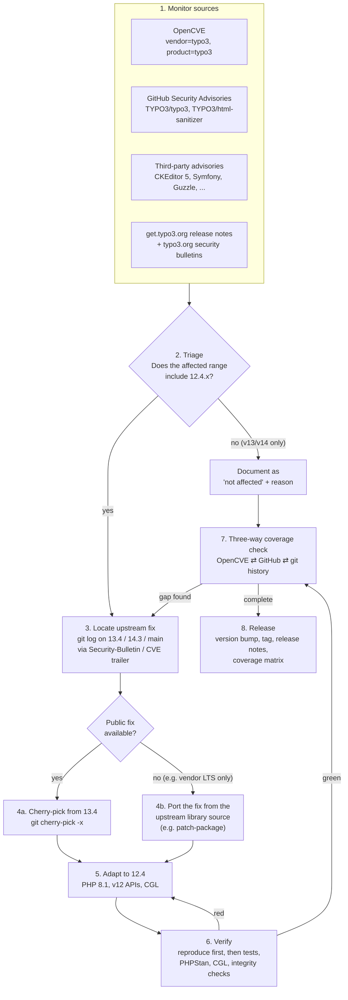
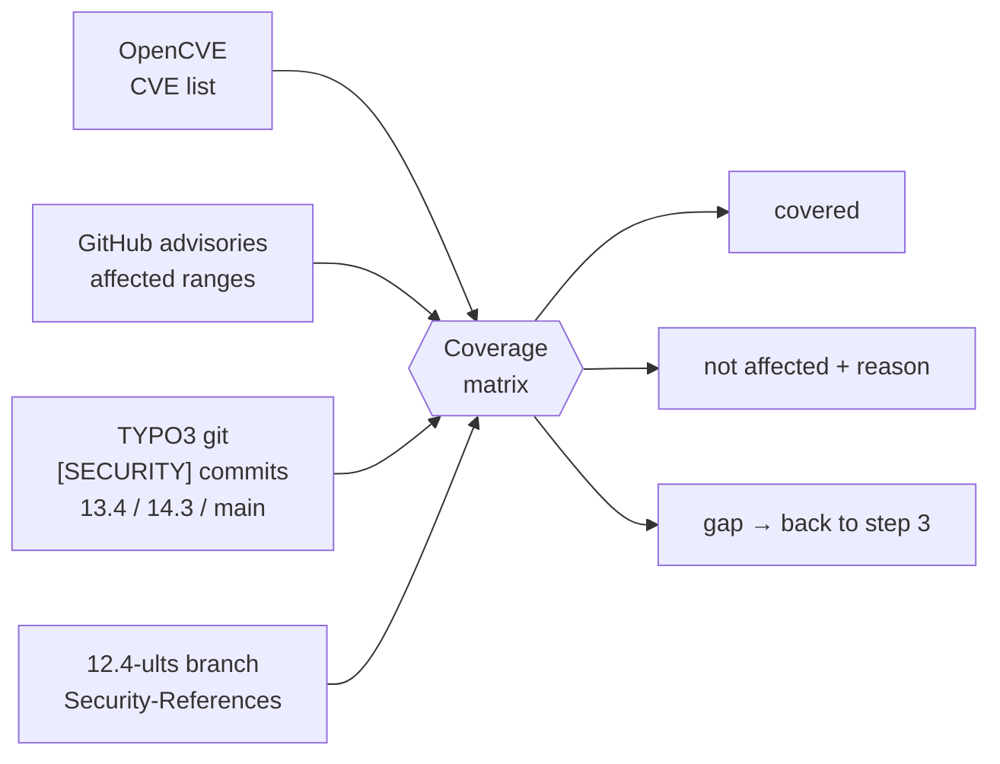

# KasperCMS 12.4 – Ultra Long Term Support (ULTS) process

This document describes how security fixes and bug fixes are tracked,
backported, verified and released for KasperCMS, the independent community
fork of TYPO3 CMS 12.4, after the end of regular community support
(2026-04-30). The list of KasperCMS releases is in the
[README](README.md#releases).

See the [trademark notice](README.md#trademark-notice) in the README.

## Scope

KasperCMS 12.4 receives:

- **Security fixes:** public TYPO3 core security fixes that affect 12.4
  (steps 1–8 below), including follow-up fixes for regressions caused by them.
  Each release documents them in its coverage matrix.
- **Bug fixes:** upstream bug fixes from the `13.4` and 14.x branches that can be
  backported to 12.4 without risk (see [Bug fix backports](#bug-fix-backports)).
- **Dependency updates:** security updates and patch-level updates of bundled
  and required libraries, staying within the major versions supported by
  TYPO3 12.4.

New features, breaking changes, database schema changes and upgrades to new
major versions of dependencies are out of scope. Exception: a new major version
is used when the security fix is only available there and TYPO3 made the same update in
its maintained branches (`enshrined/svg-sanitize` `^1.0` in 12.4.45.1, which rejects SVG
files with entity references).

## Overview (security fixes)



## 1. Monitor sources

| Source | What it tells us | Where |
|---|---|---|
| OpenCVE | All CVEs filed against TYPO3 CMS, with affected version ranges | <https://app.opencve.io/cve/?vendor=typo3&product=typo3> |
| GitHub advisories (core) | GHSA, CVE, severity, affected ranges per `typo3/cms-*` package | <https://github.com/TYPO3/typo3/security/advisories> |
| GitHub advisories (libraries) | Advisories of TYPO3-maintained libraries | <https://github.com/TYPO3/html-sanitizer/security/advisories> |
| Third-party advisories | Bundled or required libraries | [CKEditor 5](https://github.com/ckeditor/ckeditor5/security/advisories), [Symfony](https://github.com/symfony/symfony/security/advisories), [Guzzle](https://github.com/guzzle/guzzle/security/advisories), [PSR-7](https://github.com/guzzle/psr7/security/advisories) |
| TYPO3 release notes | Which fixes TYPO3 releases contain (commit subjects) | <https://get.typo3.org/> |
| TYPO3 git repository | The actual fixes, identified by commit trailers | `upstream/13.4`, `upstream/14.3`, `upstream/main` (remote `upstream`) |

Upstream security commits carry machine-readable trailers, which connect all
sources:

```
[SECURITY] Fix open redirection in GeneralUtility::sanitizeLocalUrl
...
Security-Bulletin: TYPO3-CORE-SA-2026-009
Security-References: CVE-2026-47347
```

Useful commands (the remote `upstream` is
`https://github.com/TYPO3/typo3.git`; `origin` is the KasperCMS repository):

```bash
# GitHub advisories of TYPO3 core since a date, with affected ranges
gh api 'repos/TYPO3/typo3/security-advisories?per_page=100' --paginate \
  --jq '.[] | select(.published_at >= "2026-01-01")
        | [.ghsa_id, .cve_id, .severity, .summary,
           ([.vulnerabilities[].vulnerable_version_range] | unique | join(" ; "))]
        | @tsv'

# All upstream security commits since the last 12.4 base release
git fetch upstream 13.4 14.3 main
for b in upstream/13.4 upstream/14.3 upstream/main; do
  git log "$b" --since=2026-04-14 --format='%h %s' --grep='^\[SECURITY\]'
done
```

## 2. Triage

For every CVE / GHSA, check the affected version range of the advisory:

- **Range includes 12.4.x** → continue with step 3.
- **Range covers only v13/v14** → mark as *not affected* in the coverage
  matrix. If the fix touches code that also exists in 12.4, verify by reading
  the 12.4 code. Example: CVE-2026-47350 was caused by a v13 refactoring of
  `DataHandler::moveRecord()`, and 12.4 still has the original permission
  check.
- **Third-party library** → check the version bundled or locked in 12.4
  (`composer.lock`, `Build/package-lock.json`) against the advisory's range.

## 3. Locate the upstream fix

```bash
# by CVE or bulletin id
git log upstream/13.4 --format='%h %ad %s' --date=short --grep='CVE-2026-47347'
git log upstream/13.4 --format='%h %ad %s' --date=short --grep='TYPO3-CORE-SA-2026-009'
```

The `13.4` branch is the closest code base to 12.4 and is the preferred
source. Also pick up related follow-up commits (`Related: #<issue>` or
`Related: #108604`). These are often regression fixes for the security
change itself.

## 4. Backport

```bash
git checkout 12.4-ults
git cherry-pick -x <13.4-commit>    # -x records "(cherry picked from commit …)"
```

Dependency fixes are applied with Composer inside the test container, staying
within the major version 12.4 supports (for example Symfony 6.4, not 7.4):

```bash
CI=true ./Build/Scripts/runTests.sh -p 8.1 -s composer -- req <package>:<min-version>
CI=true ./Build/Scripts/runTests.sh -p 8.1 -s composer -- req <package>:<min-version> \
  -d typo3/sysext/<ext> --no-update
CI=true ./Build/Scripts/runTests.sh -p 8.1 -s composer -- update 'symfony/*'   # never -W
```

If a library fix is not publicly available as a release for the bundled
version (for example CKEditor LTS-only releases), the fix is ported from the
library's public source repository into `Build/patches/` (patch-package), and
the frontend is rebuilt.

## 5. Adapt to 12.4

Typical adaptations, all of which occurred in 12.4.45.1:

| v13 construct | 12.4 replacement |
|---|---|
| `final readonly class` (PHP 8.2) | `final class` with `readonly` properties (PHP 8.1) |
| `TcaSchemaFactory`, `TcaSchemaCapability` | `$GLOBALS['TCA'][$table]['ctrl'][…]` |
| `Resource\Enum\DuplicationBehavior` | `Resource\DuplicationBehavior` constants |
| `DataHandler::hasPermissionToInsert()` | `DataHandler::checkRecordInsertAccess()` |
| `Core\Crypto\HashService` (new in v13) | backported as `@internal` class |
| `$this->once()` in tests | `self::once()` (12.4 CGL) |
| Changelog in `Changelog/13.4.x/` | moved to `Changelog/12.4.x/` |

Adaptations are folded into the commit they belong to (`git commit --fixup`
plus `git rebase --autosquash`), so every commit stays green on its own.

## 6. Verify

Reproduce first: where possible, a test or script must fail on the unpatched
code and pass after the fix.

```bash
CI=true ./Build/Scripts/runTests.sh -p 8.1 -s unit
CI=true ./Build/Scripts/runTests.sh -p 8.1 -s functional -d sqlite
CI=true ./Build/Scripts/runTests.sh -p 8.1 -s phpstan          # baseline must not grow
./Build/Scripts/runTests.sh -s cgl -n
for s in checkExceptionCodes checkRst checkAnnotations checkTestClassFinal \
         checkNamespaceIntegrity lintServicesYaml checkExtensionScannerRst; do
  ./Build/Scripts/runTests.sh -s "$s"
done
./Build/Scripts/runTests.sh -s unitJavascript                     # when JS/CKEditor changed
```

Tests run against PHP 8.1, the minimum PHP version of TYPO3 12.4, and
against PHP 8.3 and 8.5, the recommended versions. Before a release, the
complete unit and functional test suites also run locally on all three.

On GitHub, `.github/workflows/ci.yml` runs CGL, PHPStan, the exception code
check, the unit tests and the functional tests (SQLite, four chunks) on
PHP 8.1, 8.3 and 8.5 for every push and pull request on `12.4-ults`.

`.github/workflows/dependency-updates.yml` runs `composer update --patch-only`
on the first day of every month and opens a pull request when locked
dependencies changed. It starts the CI workflow for that branch. Pull requests
are reviewed and merged manually; minor and major updates are not automated.

## 7. Three-way coverage check

Before every release, compare all three sources. A release is only made when
every row is either *covered* or *not affected* with a reason.



```bash
# Upstream security commits without a counterpart on our branch
git log 31f881a2129..12.4-ults --format='%s' > ours.txt
for b in upstream/13.4 upstream/14.3 upstream/main; do
  git log "$b" --since=2026-04-14 --format='%s' --grep='^\[SECURITY\]'
done | sort -u | while read -r s; do
  grep -qxF "$s" ours.txt && echo "OURS     $s" || echo "MISSING  $s"
done

# Which of our commits fixes a given CVE
git log 31f881a2129..12.4-ults --format='%h %s' --grep='CVE-2026-47347'
```

Every `MISSING` entry must map to an advisory that does not affect 12.4.

### Automated check

`Build/Scripts/ultsSecurityCheck.php` automates most of this step and prints
a Markdown report:

- GitHub security advisories of TYPO3 and html-sanitizer that affect the
  base version 12.4.45,
- upstream `[SECURITY]` commits on `13.4`, `14.3` and `main` without a
  counterpart on the current branch,
- `composer audit` (production and `require-dev` separately) and
  `npm audit` for the bundled CKEditor packages,
- the security support of the PHP versions supported by TYPO3 12.4 (open
  item when the newest one ends within 12 months),
- TYPO3 core bulletins (`TYPO3-CORE-SA-…`) of the TYPO3 security RSS feed
  <https://typo3.org/rss-security>.

An item counts as handled as soon as its CVE, GHSA or TYPO3-CORE-SA identifier
is documented in this file, in a coverage matrix or in a "not affected" table.

```bash
php Build/Scripts/ultsSecurityCheck.php --fetch               # needs gh, git remote "upstream"
php Build/Scripts/ultsSecurityCheck.php --fetch --with-tests  # plus unit tests, PHPStan, CGL
```

Exit code `0` means no open items, `1` open items, `2` a check could not be
completed. The workflow `.github/workflows/ults-security-check.yml` runs the
check every day at 04:00 UTC and mails the report when open items are found
and the findings changed since the previous run (SMTP settings and recipient
in the repository secrets `SMTP_SERVER`, `SMTP_PORT`, `SMTP_USERNAME`,
`SMTP_PASSWORD` and `ULTS_MAIL_TO`). Triage (step 2) and backports stay manual.

The bug fix check (`--checks=bugfixes`) is not part of the daily security
check, so that bug fix candidates never hide security findings. See
[Bug fix backports](#bug-fix-backports).

## Bug fix backports

Upstream bug fixes are taken from the `13.4` branch, the closest code base to
12.4, and from the 14.x branches (`14.3`, `main`). Most 14.x bug fixes are
also released for 13.4; fixes that only exist on 14.x are backported when the
affected code also exists in 12.4. The bug fix check covers `13.4` by default;
run it with `--bugfix-branch=14.3` for 14.x.

### Criteria

An upstream `[BUGFIX]` commit is backported when all of the following apply:

- It was merged in 2026 or later (`--bugfix-since=2026-01-01`) and is not
  part of 12.4 yet. Fixes that TYPO3 itself backported to 12.4 before the
  base release 12.4.45 are recognised by their subject.
- The affected code exists in 12.4, and the bug can occur in 12.4.
- It does not add features, change public APIs or behaviour that
  installations rely on, change the database schema, require configuration
  changes or raise dependencies to a new major version.
- It can be adapted to 12.4 without a larger refactoring (see step 5).

Bug fixes with security impact are treated like security fixes and listed in
the coverage matrix of the release, even when upstream did not publish an
advisory (example: Forge #110844 in 12.4.45.3).

### Workflow

```bash
# Candidates: upstream bug fixes that are neither backported nor documented
php Build/Scripts/ultsSecurityCheck.php --checks=bugfixes --fetch

# Backport like a security fix (steps 4–6)
git cherry-pick -x <13.4-commit>
```

The report lists every candidate with its Forge issue and whether it applies
cleanly to the current branch. A candidate counts as handled when it was
cherry-picked (detected by the subject or the `cherry picked from commit`
line) or when its commit hash is listed in the table below with a reason.

The workflow `.github/workflows/ults-bugfix-check.yml` runs this check every
day at 05:00 UTC and mails the report in the same way when the candidates
changed.

The workflow `.github/workflows/ults-bugfix-backport.yml` runs every day at
04:00 UTC (06:00 CEST), or manually for given commit hashes. For each
candidate that
applies cleanly and has no pull request yet, it cherry-picks the commit with
`-x` to a branch `backport/<hash>`, runs CGL, PHPStan, the exception code
check and the unit and functional tests on PHP 8.1, 8.3 and 8.5 (in jobs
without write permissions), and opens a pull request labelled
`ults-backport` (a draft if a check failed). Merging stays manual: review the
change for v12 compatibility and merge with "Rebase and merge". A rejected
candidate is closed and listed in the table below.

Backported bug fixes are listed in the coverage matrix of the release that
contains them.

### Upstream bug fixes not backported

Triage of the candidates since 2026-01-01 is in progress: candidates that
apply cleanly are handled by the backport workflow, candidates with conflicts
are pending. Decisions are added here, so that the bug fix check does not
report them again.

| Commit (13.4) | Subject | Reason |
|---|---|---|
| `1acb4681598` | Handle multibyte characters in TypoScript | Changes the TypoScript parsing result of existing installations: lines with multibyte identifiers, ignored so far, would become active |
| `2c703f5aaec` | Evaluate sortDesc parameter correctly in indexed_search | Reverses the order of search results of existing installations |
| `9e3ace89048` | Remove garbage collected rows in batches | Deferred: needs an adaptation to Doctrine DBAL 3 (`Table::getPrimaryKeyConstraint()` is DBAL 4) and to the 12.4 table configuration |
| `e2f9e9950d8` | Use sprite references in SvgSpriteIconProvider inline output | Changes the inline output of the core icons from standalone SVG markup to sprite references (`<use>`), which changes the DOM existing styles and scripts rely on; an optimisation rather than a bug fix |
| `9f943cfa338` | Skip transient properties in Extbase validation | Stops the automatic recursive validation of transient child models that have public getters, so objects rejected so far would be accepted |
| `4508dac1bf1` | Respect integrityStatus option in redirects:cleanup command | Fixes the integrity status option of a v13 feature (commit 422d4777cdc, "Show the redirect integrity status"); 12.4 has neither the option nor `Demand::getIntegrityStatus()` |

## 8. Release

<a id="versioning"></a>
### Versioning

KasperCMS releases are numbered `12.4.45.N`, counting up independently with
every release:

- `12.4.45` is the last official community release this branch is based on.
- `N` is incremented for every release (`12.4.45.1`, `12.4.45.2`, …).
- Composer treats four-part versions as stable and orders them directly
  after `12.4.45`.
- Version numbers of official TYPO3 releases are never reused.
- `N` is a revision below PATCH: it contains security fixes and bug fixes
  only, like a TYPO3 patch release. See the
  [README](README.md#versioning) for the reasons behind the four-part scheme.

### Steps

1. Run `php Build/Scripts/ultsSecurityCheck.php --fetch`: it must report no
   open items. CI must be green on the code to be released, and the complete
   unit and functional test suites must pass on PHP 8.1, 8.3 and 8.5.
2. Commit `[DOCS] Prepare documentation for KasperCMS 12.4.45.N`: add the
   release with its date to the [release table in the README](README.md#releases)
   and complete its coverage matrix in this file, so that the tag contains the
   current documentation.
3. Commit `[RELEASE] Release of KasperCMS 12.4.45.N`: set
   `Typo3Version::VERSION`, pin `typo3/cms-*` requirements in all
   `composer.json` files and `Build/composer/composer.dist.json`, and update the
   `ext_emconf.php` versions.
4. Create the annotated tag `v12.4.45.N`.
5. Commit `[TASK] Set TYPO3 version to 12.4.45.(N+1)-dev`: requirements go
   back to `12.4.*@dev`.
6. Build the tarball from the tag (`git archive`, then
   `composer install --no-dev --optimize-autoloader` with PHP 8.1) and its
   SHA-256 checksum.
7. Push the branch and the tag, then publish the GitHub release with the
   tarball, the checksum and the release notes right away. The workflow
   `.github/workflows/composer-repository.yml` then attaches the Composer
   archives of all `typo3/cms-*` packages to the release, updates
   `packages.json` and rebuilds the website
   (<https://agilastic.github.io/kaspercms/>, source in `Build/Website/`,
   release data from the README release table; releases are listed once their
   tag exists).

### Known limitations

- The install tool's core update check and the Reports module query
  get.typo3.org. They only know official versions and will report a KasperCMS
  installation as outdated.
- Fixes that are not public (no 13.4/14.x counterpart, no public library
  release) cannot be cherry-picked. They are
  either ported from public upstream sources or listed as open.
- Advisory scanners compare version numbers only and report advisories fixed
  after 12.4.45 for every KasperCMS release. The coverage matrix is the
  reference for what is fixed.
- Composer 2.9+ blocks KasperCMS packages because of the advisory ranges;
  installations need a `policy.advisories.ignore` entry per package, see the
  [README](README.md#installation-with-composer).
- Tools that expect three version parts may fail on `12.4.45.N` (known: DDEV),
  see the [README](README.md#known-limitations).

## Coverage matrix: 12.4.45.8 (in development)

Changes on `12.4-ults` since 12.4.45.7. This section is completed when
12.4.45.8 is released.

### Other changes

| Change on `12.4-ults` | Notes |
|---|---|
| Dashboard widgets "About TYPO3" and "Getting Started with TYPO3" removed | Part of the KasperCMS branding: the widgets are no longer registered, and new dashboards start without default widgets. Existing dashboards skip them. The widget class `T3GeneralInformationWidget` remains for extensions that register it themselves. |

## Coverage matrix: 12.4.45.7

KasperCMS 12.4.45.7, released 2026-10-17. Checked against the GitHub
advisories, the TYPO3 security feed, `composer audit` and the TYPO3 git
history on 2026-10-17 (automated ULTS security check): no new advisories
affecting 12.4 were published since 12.4.45.6. This release contains no
security fixes.

Verification: CGL, PHPStan (PHP 8.1, 8.3 and 8.5), the integrity checks of
step 6, unit tests and functional tests (SQLite) on PHP 8.1, 8.3 and 8.5.

### Hardening

| Fix on `12.4-ults` | Type | Reference |
|---|---|---|
| Respect page permissions in the indexing module (`indexed_search`) | Hardening: the statistic, page, document and word views and the removal of index entries only cover pages the backend user may read (admins are not restricted). Before, users with access to the module could see the indexed words and titles of any page and remove its index entries. The TYPO3 Security Team does not consider this a security issue. | Fixed in KasperCMS |

### Other changes

| Change on `12.4-ults` | Notes |
|---|---|
| Comments announcing removals in past TYPO3 versions | Corrected: the backwards compatibility layers stay in 12.4; no code changes |
| CI | Unit and functional tests on PHP 8.1, 8.3 and 8.5 |

## Coverage matrix: 12.4.45.6

KasperCMS 12.4.45.6, released 2026-10-17. Checked against the GitHub
advisories, the TYPO3 security feed and the TYPO3 git history on 2026-10-17
(automated ULTS security check): no new TYPO3 advisories affecting 12.4 were
published since 12.4.45.5. `composer audit` reported one library advisory,
fixed in this release.

Verification: CGL, PHPStan (PHP 8.1 and 8.5), the integrity checks of step 6,
unit tests and functional tests (SQLite) on PHP 8.1 and PHP 8.5.

### Libraries

| Advisory | Package | Fix on `12.4-ults` |
|---|---|---|
| CVE-2026-109449 | symfony/expression-language | Raised to `^6.4.48` (unbounded nesting in the expression parser) |

### Bug fixes

Upstream bug fixes from `13.4` and 14.x (see [Bug fix backports](#bug-fix-backports)).
Most of them were proposed by the backport workflow and reviewed for 12.4
compatibility before merging.

| Fix on `12.4-ults` | Reference |
|---|---|
| Set tstamp in DatabaseWriter for sys_log | Forge #109290 |
| Enforce isEnabled() check in ResetPasswordController | Forge #109942 |
| Restore FAL permission evaluation | Forge #110687 (adapted to the 12.4 exception handling) |
| Fix exceptions due to null as array key | Forge #108334 |
| Add is_siteroot to select fields in record lists | Forge #108617 |
| Fix undefined array key warning in language menu processing | Forge #108587 |
| Prevent call to undefined ProcessedFile::setMissing | Forge #108036 |
| Mark english only content with proper lang attribute | Forge #108914 |
| Prevent losing PageLinkHandler link when re-linking | Forge #108947 |
| Fix type error in SelectItem | Forge #108989 |
| Allow CType menu_categorized in strict mode | Forge #87190 |
| Fix duplicate cache-control headers | Forge #107891 (`.htaccess` template for new installations) |
| Prevent open_basedir warnings for file thumbnails | Forge #108774 |
| Handle missing sys_file_reference in ExtendedFileUtility | Forge #109103 (without the native return type of the protected method) |
| Handle non-string keys in implodeAttributes | Forge #107188 |
| Add typecast to value checked in DataHandler | Forge #107702 |

### Not affected

| CVE | Bulletin | Reason |
|---|---|---|
| CVE-2026-109162 | TYPO3-CORE-SA-2026-024 | v14 only (triaged 2026-10-13). Regression of the v14 refactoring `cacb1b497ba`; 12.4 resolves `saveToFileMount` in `afterBuildingFinished()` after the element properties are applied and throws if the folder does not exist (verified by functional test). |

### Other changes

| Change on `12.4-ults` | Notes |
|---|---|
| Composer repository | Archives are built in UTC; `packages.json` is written from the archives attached to the releases |
| Automated workflows | The backport workflow runs the checks without write permissions; the dependency update only changes `composer.lock` |
| PHPStan | Passes on PHP 8.1 and 8.5 |

## Coverage matrix: 12.4.45.5

KasperCMS 12.4.45.5, released 2026-10-12. Checked against the GitHub
advisories, the TYPO3 security feed and the TYPO3 git history on 2026-10-12
(automated ULTS security check): no new TYPO3 advisories affecting 12.4 were
published since 12.4.45.4. This release contains no security or bug fixes.

### Other changes

| Change on `12.4-ults` | Notes |
|---|---|
| KasperCMS logo in the backend top bar and on the login page | New vector SVGs in `EXT:backend/Resources/Public/Images/`; a configured `backendLogo` or `loginLogo` still takes precedence |
| Backend colours of the KasperCMS logo | Navy `#1a2e52` for top bar, toolbar and module menu; login highlight `#1d6ff2` (contrast 4.6:1 instead of 2.4:1); a configured `loginHighlightColor` still takes precedence |
| Documentation | Four-part version scheme, Composer advisory blocking (`policy.advisories.ignore`), DDEV limitation |

Verification: unit tests on PHP 8.1, 8.5 and 8.6 and functional tests
(SQLite) in CI, PHPStan and CGL. The backend and the login page were
checked in the browser.

## Coverage matrix: 12.4.45.4

KasperCMS 12.4.45.4, released 2026-10-12. Checked against the GitHub
advisories, the TYPO3 security feed and the TYPO3 git history on 2026-10-12
(automated ULTS security check): no new TYPO3 advisories affecting 12.4 were
published since 12.4.45.3. First release with upstream bug fix backports.

Verification: unit tests (11749) on PHP 8.1, 8.5 and 8.6 and functional
tests (SQLite) in CI, PHPStan, CGL and the integrity checks of step 6. The
functional tests of the cache, DataHandler default values, console command
list, CSP policy provider, mount points and the install tool also ran on
MariaDB 10.3.

### Bug fixes

Upstream bug fixes from `13.4` (see [Bug fix backports](#bug-fix-backports)).
Where upstream added tests, they fail on the code without the fix and pass
with it, except the paginator test, which only fails on PHP 8.5+.
Adaptations to 12.4: "Run cache GC in chunks" imports `PlatformInformation`
(added upstream by an earlier 13.4 change), and the record history test does
not use the publish action, which 12.4 does not record.

| Fix on `12.4-ults` | Reference |
|---|---|
| Return modified object in PreviewUriBuilder::withRootLine | Forge #109609 |
| Combine mtime and filesize for package cache identifier | Forge #109653 |
| Run cache GC in chunks | Forge #109897 |
| Respect position "top" in EMU::addTcaSelectItemGroup() | Forge #108977 |
| Create missing var/transient in Directory Status check | Forge #109813 |
| Properly backport avoid using null as array offset | Forge #110078 |
| List `extension:activate` in list of possible commands | Forge #99396 |
| Add accessible label to language flag in content element header | Forge #108465 |
| Make LogRecord writeable ArrayAccess / offsetSet | Forge #110220 |
| Ensure that failed attempts to send via MemorySpool are logged | Forge #110174 |
| Resolve subpages of translated mount points | Forge #104252 |
| Allow non-scheme protocol URI as CSP site base | Forge #110263 |
| Fix exception on initial TYPO3 setup with empty database | Forge #110381 |
| Do not split paragraphs at inner linebreaks | Forge #88556 |
| Fix PCRE regex breaking suggest wizard on line breaks | Forge #110329 |
| Avoid deadlock in console command tests | Forge #110481 |
| Use TypoScript from request in CObjectViewHelper | Forge #110496 |
| Make CGL suites work in git worktrees | Forge #110534 |
| Restrict allowed characters of pages cache tags | Forge #107828 |
| Do not treat moved records as deleted in record history | Forge #110585 |
| Ensure admin access in "redirects:cleanup" command | Forge #110620 |
| Preserve route target when MFA intercepts a route request | Forge #109133 |
| Suppress warnings from `GeneralUtility::writeFile()` | Forge #110707 |
| Reset page TCAdefaults for each new record | Forge #110705 |
| Quote container binary check in runTests.sh | Forge #107967 |
| Prevent integer overflow in paginator offset calculation | Forge #110827 |
| Support schemeless URLs in forceAbsoluteUrl() | Forge #108603 |
| Respect abort override in pre-commit hook | Forge #110879 |

### Hardening

| Fix on `12.4-ults` | Type | Reference |
|---|---|---|
| Quote cache tags in `Typo3DatabaseBackend::flushByTag()` and `flushByTags()` | Hardening against SQL injection when the backend is called directly with unvalidated tags (core calls go through the validating cache frontend), quoting ported from a public upstream fix that was never released for 12.4 | Forge #106006 (TYPO3 13.4) |

### Frontend build toolchain

`Build/package-lock.json` is only used to build the shipped assets and is
not part of release packages. Vulnerable build tools were updated within
their major versions (`npm update`, `js-yaml` via an override for grunt).
Rebuilding the assets produces no changes.

| Advisory | Package | Fix on `12.4-ults` |
|---|---|---|
| 40 Dependabot alerts (fast-uri, js-yaml, immutable, postcss, svgo, nanoid, brace-expansion, websocket-driver, …) | Build tools | Updated within their major versions |
| ip-address, sharp, postcss-selector-parser | Build tools | Open: fixes only in a new major version |
| extract-zip, sprintf-js | Build tools | Open: no fixed version available |

### Libraries

| Advisory | Package | Fix on `12.4-ults` |
|---|---|---|
| GHSA-68fv-2mgg-jv7q | source-map-js | Updated to 1.2.2 in `Build/package-lock.json`. Not exploitable in release packages: the bundled `Contrib/css-tree.js` ships its own copy of the source map generator only, without the affected consumer for indexed source maps, and runs in the backend user's browser. |

## Coverage matrix: 12.4.45.3

KasperCMS 12.4.45.3, released 2026-10-11. Checked against the GitHub
advisories, the TYPO3 security feed and the TYPO3 git history on 2026-10-11
(automated ULTS security check): no new TYPO3 advisories affecting 12.4 were
published since 12.4.45.2.

Verification: unit tests (11722) and functional tests on PHP 8.1 in CI,
PHPStan and CGL. The live search fix comes with tests that fail without
the fix.

### Upstream bugfixes with security impact

| Fix on `12.4-ults` | Type | Reference |
|---|---|---|
| Restrict backend live search to page mounts for users without page mounts | Missing authorization check, backport of a public upstream fix that was never released for 12.4 | Forge #110844 (TYPO3 13.4) |

### Development dependencies

`composer/composer` is a `require-dev` dependency and not part of release
packages. It is raised from 2.9.3 to `^2.10.3` for developers and CI working
with this repository.

| Advisory | Package | Fix on `12.4-ults` |
|---|---|---|
| CVE-2026-40176, CVE-2026-40261, CVE-2026-45793, CVE-2026-59944, CVE-2026-59946, CVE-2026-59947, CVE-2026-59948, CVE-2026-84361 | composer/composer | Raised to `^2.10.3` |

## Coverage matrix: 12.4.45.2

KasperCMS 12.4.45.2, released 2026-10-10. Checked against OpenCVE, GitHub
advisories and the TYPO3 git history on 2026-10-10: no new TYPO3 advisories
affecting 12.4 were published since 12.4.45.1.

This release adds fixes found during a code review of KasperCMS 12.4.45.1
(deserialization, backend AJAX routes, redirects, path checks, SQL building
and raw template output).

| Fix on `12.4-ults` | Type | Reference |
|---|---|---|
| Respect table read permissions in suggest wizard | Missing authorization check | Fixed in KasperCMS |
| Streamline absolute path handling in `GeneralUtility::getFileAbsFileName()` | Hardening, backport of a public upstream fix that was never released for 12.4 | Forge #102995 (TYPO3 13.4) |

Verification: unit tests (11722) and functional tests (7798) on PHP 8.1,
PHPStan and CGL. Both fixes come with tests that fail without the fix.

## Coverage matrix: 12.4.45.1

KasperCMS 12.4.45.1, released 2026-10-10. Checked against OpenCVE, GitHub
advisories and the TYPO3 git history on 2026-10-10.

### TYPO3 core CVEs affecting 12.4.45

| CVE | Bulletin | Issue | Fix on `12.4-ults` |
|---|---|---|---|
| CVE-2026-47343 | TYPO3-CORE-SA-2026-007 | Destructive actions on file mount folders | Deny destructive write actions on mount folders |
| CVE-2026-47346 | TYPO3-CORE-SA-2026-008 | Form: mixed-case `.FORM.YAML` upload bypass | Properly detect .form.yaml suffixes in resource layer |
| CVE-2026-47347 | TYPO3-CORE-SA-2026-009 | Open redirect in `sanitizeLocalUrl` | Fix open redirection in GeneralUtility::sanitizeLocalUrl |
| CVE-2026-47349 | TYPO3-CORE-SA-2026-011 | Recycler restores without permission | Validate permissions on record undelete |
| CVE-2026-49742 | TYPO3-CORE-SA-2026-013 | Download from FAL fallback storage | Avoid download from fallback storage in FileDownloadController |
| CVE-2026-47351 | TYPO3-CORE-SA-2026-014 | Clipboard without read permission checks | Check record/file access when adding records to clipboard |
| CVE-2026-47352 | TYPO3-CORE-SA-2026-015 | File metadata via backend API | Check file permissions before showing meta data |
| CVE-2026-49738 | TYPO3-CORE-SA-2026-016 | Path prefix confusion in `isAllowedAbsPath` | Fix path prefix confusion in isAllowedAbsPath |
| CVE-2026-49740 | TYPO3-CORE-SA-2026-018 | Insecure deserialization (cache, registry) | Mitigate deserialization flaws (+ 2 prerequisite and 4 follow-up commits) |
| CVE-2026-11607 | TYPO3-CORE-SA-2026-019 | Form: non-`.form.yaml` files as definitions | Properly evaluate .form.yaml file extension |
| CVE-2026-77132 | TYPO3-CORE-SA-2026-022 | Localization wizard information disclosure | Check page access in the localization endpoints |

### Libraries

| Advisory | Package | Fix on `12.4-ults` |
|---|---|---|
| CVE-2026-47344, CVE-2026-47345 (TYPO3-CORE-SA-2026-006) | typo3/html-sanitizer | Raised to v2.3.2 |
| GHSA-v6mg-96c6-gmpq | CKEditor 5 engine (bundled v44.1.0) | `data:` URI filtering ported from v47.7.4 into `Build/patches/` |
| GHSA-jrqm-vmqc-gm93 | CKEditor 5 html-support | Already covered by existing 12.4 patches |
| GHSA-m9xh-6747-9r6f, GHSA-9rjx-3jch-6vjf, GHSA-v383-3rw5-q8rf, GHSA-qhmf-972w-m957 | enshrined/svg-sanitize | Updated to ^1.0 |
| 9 advisories (host confusion, CRLF injection, cookie scope, …) | guzzlehttp/guzzle, guzzlehttp/psr7 | guzzle ^7.15.2, psr7 ^2.12.3 |
| Symfony 6.4 advisories fixed in 6.4.40/6.4.41 | symfony/* | Updated within v6.4 |

### Not affected

| CVE | Bulletin | Reason |
|---|---|---|
| CVE-2026-47348 | TYPO3-CORE-SA-2026-010 | v13+ only. 12.4 escapes all search result titles (verified in code). |
| CVE-2026-47350 | TYPO3-CORE-SA-2026-012 | v13+ only. Regression of a v13 refactoring, and 12.4 keeps the source permission check (verified in code). |
| CVE-2026-49741 | TYPO3-CORE-SA-2026-017 | v14 only (`form_definition` table) |
| CVE-2026-15305 | TYPO3-CORE-SA-2026-020 | v14.2+ only |
| CVE-2026-19418 | TYPO3-CORE-SA-2026-021 | v13+ only |
| CVE-2026-85400 | TYPO3-CORE-SA-2026-023 | v14.2+ only |
| CVE-2026-6553 | – | v14.2 only |
| GHSA-rh54-vffm-5fvp | – | CKEditor ≥ 45 only (`es-toolkit`), 12.4 bundles v44.1.0 |

Earlier 2026 advisories (CVE-2025-59020, CVE-2025-59021, CVE-2025-59022,
CVE-2026-0859) are already fixed in the 12.4.45 base release.
